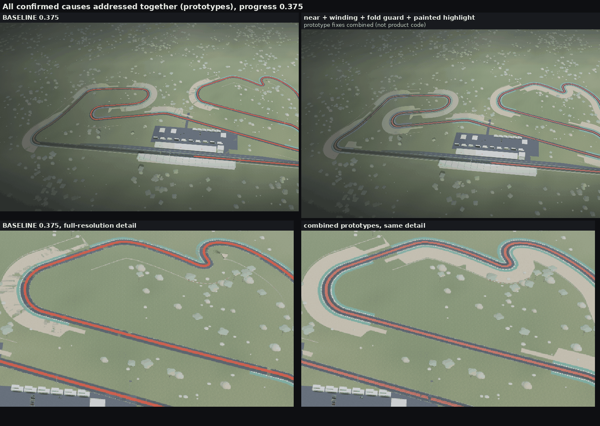

# Aerial-view track glitch: diagnosis

Symptom: between pit lane and on-track views (journey progress ≈ 0.345–0.40) the overhead shot shows fragmented
runoff/gravel areas, broken kerbs and white lines, grass blocks inside the asphalt and a thick red highlight tube.

This document confirms or refutes each suspected cause with isolated before/after renders: one change per experiment,
the same frames, the same capture procedure. No product code is changed by this work (the experiments were
flag-gated, captured, and reverted). Fix recommendations are at the end.

## Summary

| # | Cause | Verdict | Evidence | Key numbers |
|---|---|---|---|---|
| H1 | Depth precision (near 0.3 / far 9000, ground layers stacked 2–120 mm apart) | **Confirmed. Dominant cause of the "fragmented" look from 0.355 to 0.39** | [h1-depth-aerial.png](h1-depth-aerial.png), [h1-flicker.png](h1-flicker.png) | 24-bit depth step at the 0.375 look-at point (811 m): **13.1 cm**, versus layer gaps of 2–90 mm. Only the near plane changed (0.2 × eye height): 2,833 px change at 0.375, and the shimmer from a 1 cm camera move drops 3,857 → 296 px (−92 %) |
| H2 | Strip winding: `buildStrip()` faces strips down when offset A < offset B | **Confirmed. Missing kerbs, runoff, gravel and one white line at every distance** | [h2-winding.png](h2-winding.png) | 23 of 48 strips face down (9 kerbs, 9 runoffs, 4 gravel beds, 1 edge line); 4 of 9 barrier walls face away from the track; fixing only the winding changes 2.6 % of the 0.375 frame and 31 % of a top-down close-up |
| H3 | Offset strips fold over at tight bends | **Confirmed, but local.** Severe in close-ups; ≈ 100 px in the aerial frames | [h3-fold.png](h3-fold.png) | Tightest bend R = 7.6 m at (228, −156), versus inner kerb 8.1 m and inner runoff 12 m; gravel up to 36 m inside an R 23.5 m bend; 16 inverted triangles (189 m²) in 3 strips → 0 with the prototype |
| H4 | Red highlight `TubeGeometry` (r 1.9 at y 0.6) revealed with `setDrawRange` | **Confirmed** | [h4-tube.png](h4-tube.png) | A hexagonal prism 3.29 m wide (≈ 25 % of the track) standing 2.5 m tall, half of its rim below the road; 1.5–1.7 % of all frame pixels at 0.355–0.395; reveal in whole triangles of 12-triangle rings; the head moves up to 125 m per 0.001 progress (375 m per 15 px scroll step) |
| O1 | Motion blur switches on (0.39) while the camera is still airborne | **Confirmed** | [other-blur.png](other-blur.png) | After a 0.003 scroll step (15 px), frame sharpness (mean gradient) drops 26 % at 0.395, 30 % at 0.400 and 47 % at 0.410 versus no blur; 2.1–2.2 % of pixels change |
| O2 | Shadow frustum (±70 m) follows the car during the aerial | **Confirmed** (secondary) | [other-shadow-tufts.png](other-shadow-tufts.png) | Only the shadow frustum widened: 16 k px (1.2 %) change at 0.375, i.e. shadows missing outside a 140 m square |
| O3 | Sub-pixel alpha-tested grass tufts placed on the gravel beds | **Confirmed** (secondary; the dark specks at 0.345) | [other-shadow-tufts.png](other-shadow-tufts.png) | Only the tufts hidden: 697 px of dark specks disappear at 0.345 (7 px at 0.375) |
| O4 | Pit entry/exit polygons overlapping the asphalt | Confirmed by geometry, minor | (numbers only) | 0.2 m band at a 2 mm gap (aliases beyond ≈ 115 m) |
| O5 | Fog | **Refuted** as a cause | [h1-depth-aerial.png](h1-depth-aerial.png) | Linear 140→3300 m: 21 % at 800 m, uniform, cannot fragment geometry |
| O6 | three r170 `reverseDepthBuffer` as a fix | Available (EXT_clip_control present) but **broken in r170**; no portable gain with a 24-bit canvas depth buffer | [h1-depth-aerial.png](h1-depth-aerial.png) | As shipped: black frame (clip mode NEGATIVE_ONE_TO_ONE, clear depth 1.0 + GEQUAL); patched: renders, but shadow maps break (42 k px change at 0.345) |



With every confirmed cause addressed at once (prototypes `near` + `wind` + `fold` + `paint`), 51 k px (4.0 %) of the
0.375 frame change (44.7 k px, 3.5 %, at 0.355).

## Method

* **Isolation.** Every experiment is one code change behind a URL flag (`?exp=…`, read in a temporary `exp.js`),
  built once. With no flags, the experiment build is **bit-identical to the HEAD build** (max channel difference 0 on
  the 8 quick-parity frames). Both builds differ from the stored `parity-quick` reference in the same way
  (max 1 at 0.345/0.370, max 20 at 0.400), so that difference comes from the environment, not from the flags.
  The flags and their single change:

  | flag | the one change |
  |---|---|
  | `near` | `camera.near = max(0.3, 0.2 × eye height)` per frame (far unchanged, 9000) |
  | `logdepth` | `new WebGLRenderer({ logarithmicDepthBuffer: true })` |
  | `revz` / `revzfix` | `reverseDepthBuffer: true`; `revzfix` also works around the first two r170 bugs below (clip control `ZERO_TO_ONE`, `clearDepth(0)`) |
  | `wind` | `buildStrip()` emits `(i, i+1, i+2), (i+1, i+3, i+2)` when the first offset < the second |
  | `fold` | `buildStrip()` holds an edge vertex that would move backwards along the local tangent, and collapses any quad that is still inverted |
  | `notube`, `ribbon`, `paint` | hide the tube; replace it with a flat ribbon + shader reveal; paint the highlight into the asphalt shader |
  | `noblur` | motion-blur amount forced to 0 |

* **Frames.** 1440×900, `q=high`, SwiftShader. Frames are taken at 0.336, 0.345, 0.355, 0.365, 0.375, 0.385, 0.395 and
  0.400, through the page's capture hook. Each frame is rendered twice at the same position, so the motion-blur
  "previous view-projection" is the current one and blur cannot confound the comparison (blur is measured separately
  under O1). Close-ups use `journey.debugCam` (exposed through a temporary `window.__journey`) at progress 0.33, where
  the tube is still invisible and blur is off.
* **Numbers.**
  * *Changed pixels*: pixels whose max channel difference exceeds 24/255 between two configurations.
  * *Flicker*: the same frame rendered again with camera and target shifted 1 cm along x. Correct geometry moves by a
    few hundredths of a pixel and stays put; z-fighting pixels flip. The count of changed pixels measures the
    shimmer a user sees while the camera moves.
  * *Geometry*: Node scripts replicate every `buildStrip()` / `buildBarrierWall()` call of `world.js` (same inputs,
    same code) and report normal direction, inverted triangles (signed XZ area against the strip's majority) and
    curvature.
* Scripts used (kept out of the repo, summarised here): `xcap.mjs` (flags × frames capture), `strips.mjs`,
  `walls.mjs`, `tube.mjs`, `depth_table.py`, `depthfmt-probe.mjs`, `revz-probe.mjs`.

## H1: depth precision (confirmed, dominant)

The camera is `PerspectiveCamera(36, aspect, 0.3, 9000)` for the whole journey. In a 24-bit depth buffer one step
(LSB) at view distance z is `z² (f − n) / (n f 2²⁴) ≈ z² / (n · 2²⁴)`:

| camera key (progress) | eye height | distance to look-at | elevation | LSB, near 0.3 | LSB, near = 0.2 × eye height | LSB, log depth |
|---|---|---|---|---|---|---|
| 0.345 | 60 m | 219 m | 16° | 1.0 cm | 0.24 mm (near 12) | 0.12 mm |
| 0.375 | 620 m | 811 m | 50° | **13.1 cm** | 0.31 mm (near 124) | 0.44 mm |
| 0.400 | 220 m | 397 m | 34° | 3.1 cm | 0.21 mm (near 44) | 0.22 mm |

The ground layers overlap in plan and are stacked far closer than that. Seen at 50° (view-depth gap = height gap / sin 50°),
each pair aliases beyond:

| overlapping pair (world.js) | height gap | aliases beyond |
|---|---|---|
| terrain (y −0.05) under asphalt (0.03), gravel (0.035), runoff (0.04) | 80–90 mm | ≈ 725 m |
| asphalt (0.03) vs white edge lines (0.045) | 15 mm | ≈ 314 m |
| asphalt vs rubber line (0.034, has polygonOffset −1/−1) | 4 mm | ≈ 162 m |
| pit asphalt (0.025) vs top of the pit-lane line box (0.042) | 17 mm | ≈ 334 m |
| pit entry/exit polygons (0.028) vs asphalt, 0.2 m band | 2 mm | ≈ 115 m |

At 0.375 the visible ground runs from about 600 m to 1100 m away, so even the 8 cm terrain gap is below one LSB over most
of the frame. Grass wins pixels inside the asphalt and the gravel beds, which reads as "fragmented runoff" and "broken track".
(Kerbs and runoff only share an edge, never an area, so they do not z-fight with each other.)

**Isolated test** ([h1-depth-aerial.png](h1-depth-aerial.png)). Changing only the near plane removes the grass streaks in
the gravel and the grass blocks in the asphalt. Pixels changed by `near` alone: 4 px at 0.336, 56 at 0.345, 882 at 0.355, 1,656 at 0.365, **2,833 at 0.375**, 1,954 at 0.385, 368 at 0.395. `logarithmicDepthBuffer` gives
the same clean surfaces; it differs from `near` only on 1-px edges along the tube and the buildings (2.5 k px at 0.375).

**Shimmer test** ([h1-flicker.png](h1-flicker.png)): pixels that flip when the camera and target move 1 cm.

| configuration | 0.345 | 0.365 | 0.375 | 0.385 |
|---|---|---|---|---|
| baseline (near 0.3) | 337 | 2,071 | 3,857 | 2,344 |
| near = 0.2 × eye height | 301 | 371 | 296 | 497 |
| logarithmic depth | 365 | 474 | 340 | 487 |
| reverse-Z, patched (float32 depth in SwiftShader) | 281 | 387 | 307 | 506 |

The baseline flips 2.1–3.9 k px at 0.365–0.385. The flips sit in the gravel beds, along the asphalt edges and lines, and on the pit straight, not on silhouettes. Any of the three depth changes cuts that by **79–92 %**. The remaining 300–500 px are at the same level in all three configurations: sub-pixel edges and tufts. At 0.345 (eye 60 m, 1 cm LSB) there is little z-fighting to remove.

**Reverse-Z (three r170 `reverseDepthBuffer`).** `EXT_clip_control` is exposed in this Chromium, so
`capabilities.reverseDepthBuffer` is `true`, but r170's implementation is broken:

1. `WebGLState.DepthBuffer.setReversed(true)` tests the *old* value, so it sets `NEGATIVE_ONE_TO_ONE` instead of
   `ZERO_TO_ONE` (read back: `CLIP_DEPTH_MODE = NEGATIVE_ONE_TO_ONE`).
2. The depth clear value is never flipped: `DEPTH_CLEAR_VALUE` stays 1.0 while the depth func becomes `GEQUAL`, so every
   fragment fails and the frame is black (centre pixel `0,0,0`, 782 draw calls).
3. With both patched at runtime (`revzfix`), the scene renders but shadow maps break: shadows disappear, and
   42 k px change at 0.345.

Its clean result at 0.375 does not transfer to real GPUs. A raw WebGL2 probe shows that this SwiftShader stores the
"24-bit" default depth buffer **as float32**: it resolves a 1e-9 step at depth 1e-4, and a 3e-8 step at 0.5, both of which
are impossible for a 24-bit unorm buffer. With a true D24 unorm buffer (the usual default framebuffer), reversing the
mapping changes nothing: the step stays z² / (n · 2²⁴). Reverse-Z only pays off with a 32-bit float depth attachment.

## H2: winding (confirmed)

`buildStrip(points, offA, offB)` emits `(i, i+2, i+1), (i+1, i+2, i+3)`, where vertex `2k` sits at offset A and `2k+1`
at offset B along `N = (−dz, dx)`. The face normal is `(0, (A − B) · ds, 0)`, so every strip with A < B faces down and
is back-face culled from above (all these materials are `FrontSide`). `computeVertexNormals()` also gives such strips
downward normals, so a blanket `DoubleSide` would render them unlit. That is not a fix.

Every call in `world.js` (computed normals, `strips.mjs`):

| strip (world.js) | offsets A → B | facing |
|---|---|---|
| track asphalt | +p → −p | up |
| rubber line | 2.6+D → −3.4+D | up |
| white edge line, side +1 | p−0.15 → p−0.45 | up |
| **white edge line, side −1** | −(p−0.15) → −(p−0.45) | **down** |
| **kerb, side +1** (9 corners) | p → p+1.6 | **down** |
| kerb, side −1 (9 corners) | −p → −(p+1.6) | up |
| **runoff, side +1** (9 corners) | p+1.6 → p+5.5 | **down** |
| runoff, side −1 (9 corners) | −(p+1.6) → −(p+5.5) | up |
| gravel, k = −1 (corners 1, 2, 3, 5, 7) | −(p+5.5) → −(p+29.5) | up |
| **gravel, k = +1 (corners 4, 6, 8, 9)** | p+5.5 → p+29.5 | **down** |

That is **23 of 48 strips face down**: every corner loses its + side kerb and runoff, 4 of 9 gravel beds vanish, and one
edge line is missing around the whole lap. `buildBarrierWall()` has the same pattern: its normal is always +N, so the
walls at corners 4, 6, 8 and 9 (k = +1) **face away from the track** (0/61, 0/73, 12/251 and 0/15 normals point toward
the centre line).

**Isolated test** ([h2-winding.png](h2-winding.png)): only the index order changes. Pixels changed: 2.6 % of the frame at
0.375 (33 k px), 2.4 % at 0.365, 1.0 % at 0.345, and 31 % of the top-down close-up. Down-facing strips: 23 → 0.

## H3: folding at tight bends (confirmed, local)

The centre line has 1000 samples, one every 4.2 m. Its tightest bend is **R = 7.6 m at sample 584, (228, −156)**
(8.4 m and 10.1 m on either side). An offset edge folds when the offset exceeds R on the inner side:
the inner kerb reaches 8.1 m and the inner runoff 12 m. Even the asphalt edge (6.5 m) sits at 0.86 R.
"Corner 8" (samples 539–773, ≈ 980 m) is one merged range that contains bends in both directions, and its gravel
(k = +1, up to 36 m out) lies on the *inside* of the R 23.5 m bend at (229, −200).

Inverted triangles (signed XZ area against the strip's majority orientation, `strips.mjs`):

| strip | inverted | area |
|---|---|---|
| corner 8 gravel, side +1 | 11 | 179.7 m² |
| corner 8 runoff, side −1 | 4 | 9.3 m² |
| corner 8 kerb, side −1 | 1 | 0.3 m² |
| **total** | **16** | **189 m²** |
| with the fold-guard prototype | **0** | 0 |

H2 and H3 interact ([h3-fold.png](h3-fold.png)). The corner 8 gravel strip faces down, so the only parts of it you can see
from above are its *folded* triangles, which flip up into a fan of wedges and spikes. Fix the winding alone and the
same triangles flip down and leave holes; the inner kerb's fold leaves a grass hole at the apex. The fold guard removes all
of them. In the aerial frames the bend is small: the guard changes 97 px at 0.365 and 80 px at 0.375. In the top-down
close-up it changes 2.3 k px; adding the near fix changes only 31 px more, so at 150 m depth precision is not involved.
The close-ups also show the coarse sampling: at R 7.6 m each 4.2 m segment turns 31°, and the outer kerb is visibly faceted.

## H4: the red highlight tube (confirmed)

`new TubeGeometry(CatmullRomCurve3(track at y 0.6, closed), 1200, 1.9, 6, true)`, `MeshBasicMaterial` (opacity 0.95,
`depthWrite: false`, `fog: false`, `renderOrder 5`), revealed with `setDrawRange(0, floor(D · smoothstep(ae) / 3) · 3)`:

* It is a **hexagonal prism 3.29 m wide** (24–25 % of the 13–14 m track) whose top stands **2.5 m** above the road. Three
  of its six rim vertices lie at y ≤ −0.35, and 40 % of the circle is under the asphalt plane. The road's depth hides the
  buried half, so the band's edges are a depth intersection of a 6-sided prism with the road, aliased and subject to
  every H1 precision problem. Close up it reads as a red wall standing on the straight (see the close-ups in
  [h4-tube.png](h4-tube.png)).
* The reveal cuts **whole triangles of a 12-triangle ring**: e.g. at 0.345 there are 102 full rings plus 7/12 of the head
  ring, at 0.375 1051 rings plus 3/12. The head is an open, partially drawn hexagon.
* The head moves up to **125 m per 0.001 progress**. The journey scrolls 4860 px at 1440×900, so the whole reveal
  (0.336–0.386) takes **243 px of scroll**, and a 0.003 step per frame (15 px) jumps the head **375 m**.
* `fog: false` against a fogged ground (21 % fog at 800 m) makes the band read more saturated and "on top" than
  the surface it marks.
* `J.push(J[0].clone())` *and* `closed: true` duplicate the seam point at (−534, 206), so the curve has a zero-length
  segment at the start of the lap.

**Alternatives tested** (same frames, same cameras): `ribbon` is a flat strip at y 0.06 with a per-vertex normalised arc
length, a `smoothstep` feathered head and a width scaled with distance. `paint` mixes the red into the asphalt shader
from the track's own `uv.y` (arc length / 12 m): no extra geometry, no depth interaction, and a reveal that is
continuous at any angle. In the close-ups ([h4-tube.png](h4-tube.png)) the tube is a red wall with an open, cut head. The ribbon and the paint
lie on the road with a feathered head, and the paint takes the grandstand's shadow like real paint. In the aerial frames,
pixels differing from "no highlight" at 0.365 are 18.9 k for the tube, 14.8 k for the paint and 9.7 k for the ribbon.
Caveat: at 0.345 (eye 60 m, 16° elevation, track 200–600 m away) the flat versions almost vanish (tube 1,625 px, paint
387, ribbon 117). The tube is only visible there *because* it stands 2.5 m tall. If the highlight must read at that
grazing angle, use a line expanded to a constant pixel width in screen space, depth-tested against the road
(see recommendation 4), not a taller solid.

## Other causes found in the frames

**O1: motion blur over the airborne part (confirmed).** The blur weight
`On = smoothstep((Et − 0.39) / 0.035) · …` turns on at 0.39, while the camera is still flying from 300 m altitude at
0.395 down to the car at 0.425. The camera moves hundreds of metres per frame (see H4: 15 px of scroll = 0.003 progress),
so the reconstructed velocities far exceed the 0.016-uv clamp (23 px at 1440 wide). For example, between 0.395 and
0.400 the eye moves ≈ 60 m per 0.003 step at ≈ 400 m from the ground, ≈ 0.2 uv. The aerial frames 0.39–0.405 are smeared.
Measured with a 0.003 progress step before each frame (15 px of scroll), compared with blur forced to 0: sharpness (mean absolute gradient) 3.22 vs 4.33 at 0.395 (−26 %), 2.98 vs 4.27 at 0.400 (−30 %), 2.46 vs 4.19 at 0.405 (−41 %), 2.14 vs 4.02 at 0.410 (−47 %); 2.1–2.2 % of pixels change by > 24/255 ([other-blur.png](other-blur.png)). The blur also depends on the *previous rendered frame* (`b.prev`): capture stills at ≥ 0.39 change with the
order of the requested positions. That history dependence is the likely reason the stored parity reference differs at
0.400 (max 20) from both the HEAD build and the experiment build here.

**O2: shadow frustum follows the car (confirmed, secondary).** When the eye is above 40 m, the 140 × 140 m
orthographic shadow box is centred on the car (`Me.y > 40 && mn.copy(lt.p)`), so in the aerial only a square around the
car has shadows, cut by a hard edge (the dark block at the west end of the grandstand at 0.375). Widening only the shadow frustum to ±900 m changes 16 k px (1.2 %) at 0.375: the grandstand, pits and trees cast shadows across the whole circuit instead of inside one square ([other-shadow-tufts.png](other-shadow-tufts.png)).

**O3: sub-pixel grass tufts (confirmed, secondary).** 3000 alpha-tested 1 × 0.62 m quads are placed 12–34 m from the
centre line, which overlaps the gravel beds (offsets 12–36 m). From 300 m and more they become isolated dark pixels
along the runoff and gravel: the "speckles" at 0.345, which no depth change removes. Hiding only the tufts removes 697 px of specks at 0.345 (7 px at 0.375, where they cover almost no pixels).

**O4: other coplanar overlaps (minor).** The pit entry/exit polygons (y 0.028) overlap the asphalt (0.03) in a 0.2 m band
where they meet the track edge (`straightZ − 6.8` against the track edge at `straightZ − 7`).

**O5: fog (refuted).** Linear fog from 140 to 3300 m gives 21 % at 800 m. It is uniform across the frame and cannot
create the blocky, view-dependent patterns. The patterns change with the near plane and with the winding, not with fog.

*Unrelated to this glitch:* in a 1440 px viewport the canvas measures 1425 px, so every capture has a 15 px light strip on
the right, and the aspect correction changes a 30° debug FOV to 30.15°.

## Recommended fixes

Fix in this order: H1 and H2 explain most of what users see; H4 is a redesign; H3 is local but visible in any future close-up.

### 1. Depth: a near plane that follows the shot (`src/journey/journey.js`, `Pi()`)

In the camera block, after `l.fov = be` and before `l.updateProjectionMatrix()`:

```js
// Depth range follows the shot. Close-ups (eye 1–3 m) keep near ≈ 0.3–0.6 m; aerials push it out with altitude.
// 0.2 × eye height stays in front of anything lower than 0.8 × eye height (tallest structure ≈ 20 m).
l.near = clamp(0.2 * Me.y, 0.3, 150);
l.far = 9000; // the sky dome (r 8000, centred on the origin) must stay inside: camera never > 900 m from the origin
```

* Tested (`near`): at 0.375 the LSB drops from 13 cm to 0.3 mm. Close-ups are untouched (eye ≤ 1.5 m → 0.3), and the
  0.59–0.635 chase keys (eye 3.0–3.2 m) get 0.6 m with the car 11–12 m away.
* **Sky dome**: it is drawn with `depthWrite: false` and stays far inside `far`, so it remains visible. The depth clear
  stays 1.0, so the blur pass's sky test (`d > .99999`) is unaffected.
* **Motion-blur reconstruction**: the blur pass rebuilds world positions with `uInvVP = inverse(projection · view)` of the
  *same* frame, and reprojects them with the previous frame's `uPrevVP`. A per-frame near is therefore consistent by
  construction, because both matrices come from `l.projectionMatrix` as it was when each frame rendered. Keep
  `b.vp.multiplyMatrices(l.projectionMatrix, l.matrixWorldInverse)` *after* the near update (it already is). Tested:
  identical blur at 0.400/0.405 under a 0.003 scroll step (134 px differ at 0.400 and 5 px at 0.405, against 26.8 k px between blur and no blur).
* Do **not** switch to `logarithmicDepthBuffer`. It fixes precision, but it writes `gl_FragDepth` in every material
  (no early-z on mobile), the custom `ShaderMaterial`s (sky, blur mask) would need the logdepth chunks, and the blur
  pass decodes depth as standard NDC (`d * 2. - 1.`), which gives wrong velocities (tested: under the same 0.003 step it changes 22.6 k px at 0.400 and drops sharpness from 2.98 to 1.97, so it smears more than the real motion).
* Do **not** rely on `reverseDepthBuffer` in r170 (three bugs above). Even fixed, it helps only with a float depth
  attachment, i.e. rendering into a `WebGLRenderTarget` with `DepthTexture(FloatType)` (`DEPTH_COMPONENT32F`), with the
  blur pass changed to read `ndcZ = d` (ZERO_TO_ONE) against the *reversed* projection and the sky test to `d < 1e-6`.
  This is a larger change than the near plane, and buys nothing the near plane does not.
* Keep the layer stack at ≥ 5 mm and put flat ground decals (rubber, lines) on `polygonOffset` with distinct units. With
  near = 0.2 × eye height every gap ≥ 2 mm resolves at 1100 m (LSB 0.6 mm at near 124). Lower the pit entry/exit polygons
  to 0.02 (1 cm under the asphalt rather than 2 mm).

### 2. Winding (`src/journey/track/strip.js`, `buildStrip()` and `buildBarrierWall()`)

Pick the triangle order from the sign of the offsets, so every strip faces +y whatever the caller passes:

```js
const a0 = typeof t == 'function' ? t(first) : t, b0 = typeof e == 'function' ? e(first) : e;
const up = a0 > b0; // vertex 2k at offset A, 2k+1 at offset B, N = (−dz, dx)
up ? u.push(x, x + 2, x + 1, x + 1, x + 2, x + 3) : u.push(x, x + 1, x + 2, x + 1, x + 3, x + 2);
```

`computeVertexNormals()` then gives +y normals, so lighting is right too. Do not use `DoubleSide`. In
`buildBarrierWall()`, flip the order when the wall offset is positive (k = +1), so the face looks at the centre line. Add a
build-time assertion: the mean normal.y of every strip is > 0, and every wall normal points to the centre line.
`strips.mjs`/`walls.mjs` can be turned into a unit test.

### 3. Folding (`buildStrip()`, plus the corner ranges in `world.js`)

* **Centre line**: resample the track to ≤ 1 m spacing (Catmull-Rom on `M.pts`), with a minimum radius of 15 m. The data
  has a 31° kink per segment at sample 584. That removes the fold at its source and the faceting seen in the close-ups.
* **Offset edges**: for each edge offset `o`, compute the local signed curvature κ (central differences over a window of
  ±⌈|o| / ds⌉ samples). On the inner side (sign(o) = sign(κ)), limit the offset to 0.9 / |κ|. After resampling (R ≥ 15 m) only the outer
  runoff edge and the gravel can reach this limit. Keep the tested
  non-retrograde guard as a safety net: hold an edge vertex whose advance along the local tangent is < 5 cm, and collapse
  a quad that is still inverted. Prototype result: 16 inverted triangles → 0.
* **Gravel side**: split each corner range (`x` in `world.js`) where `g[]` changes sign, and choose `k = −sign(g)` per
  sub-range. Corner 8 is one 980 m range with bends in both directions today, so its gravel lies inside some of them.

### 4. Highlight (`src/journey/journey.js`, replace the `TubeGeometry` / `setDrawRange` block)

Paint it into the track instead of drawing a separate solid:

* `onBeforeCompile` on the asphalt material (the `track` mesh): uniforms `uHRev`, `uHOp`, `uLap`; after
  `#include <map_fragment>`, `s = vMapUv.y * 12. / uLap`. Then
  `hA = uHOp · (1 − smoothstep(uHRev − feather, uHRev, s)) · (1 − smoothstep(0.15, 0.2, |vMapUv.x − 7/12|))`, and mix
  `uHCol` into `diffuseColor`, plus a little emissive. This was tested as `paint`.
* If a separate object is preferred, use a flat ribbon with the same arc-length attribute and `smoothstep` reveal
  (tested as `ribbon`), above the ground layers with `polygonOffset`. Expand it in screen space (a constant 3–6 px, like
  `LineMaterial`), because a world-space ribbon becomes sub-pixel at grazing angles: at 0.345 (16° elevation) the tested
  flat ribbon nearly vanishes in the distance.
* Drive the reveal from damped time, not raw progress, or stretch it over the whole aerial window. Today a 15 px scroll
  step moves the head 375 m.
* Remove the duplicate seam point (`J.push(J[0].clone())` with `closed: true`).

### 5. Others

* **Blur** (`Pi()`, `On`): start the blur window after touchdown (≥ 0.42), or multiply by `1 − smoothstep(5, 40, Me.y)`.
  In `renderAt()`, copy the current view-projection into `b.prev` before rendering, so stills do not depend on the
  previous capture.
* **Shadows** (`Pi()`, the `Me.y > 40` branch): scale the orthographic extents with altitude (e.g. half-size
  `clamp(0.9 · visible ground radius, 70, 900)`, keeping the texel snapping in `nt()`) instead of re-centring a
  140 m box on the car.
* **Grass tufts** (`world.js`, tuft `InstancedMesh`): exclude the gravel/runoff bands (offset 5.5–36 m at corners) when
  placing them, and fade them out by distance in the existing `onBeforeCompile` (scale to 0 beyond ≈ 150 m, or
  `alphaToCoverage`).

## Evidence files

| file | what it shows |
|---|---|
| [h1-depth-aerial.png](h1-depth-aerial.png) | 0.375 crops: baseline vs only-near, only-log-depth, only-reverse-Z (patched) |
| [h1-flicker.png](h1-flicker.png) | pixels that flip when the camera moves 1 cm (baseline vs depth fixes) |
| [h2-winding.png](h2-winding.png) | top-down close-up and aerial crop, baseline vs winding only |
| [h3-fold.png](h3-fold.png) | the tight bend, top-down: baseline, winding only, winding + fold guard |
| [h4-tube.png](h4-tube.png) | the tube across 0.345–0.395, and close-ups: tube vs ribbon vs painted highlight |
| [other-blur.png](other-blur.png) | 0.400 after a 0.003 scroll step: blur on/off, and the blur under near vs log depth |
| [other-shadow-tufts.png](other-shadow-tufts.png) | shadow box vs widened frustum; grass tufts vs hidden |
| [combined-before-after.png](combined-before-after.png) | 0.375 overview and full-resolution detail: baseline vs all prototypes together |

Reproduce: build with a temporary `exp.js` flag reader, serve, and capture the same positions per flag with
`window.__cap(t)` called twice per frame (to neutralise the blur history). The geometry numbers come from running
`buildStrip()`/`buildBarrierWall()` in Node with the same inputs as `world.js`.

